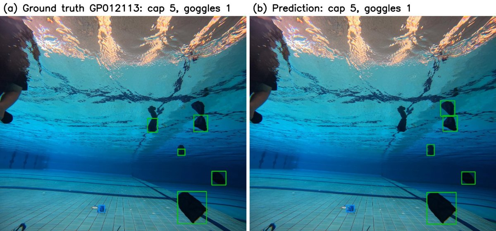
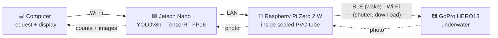
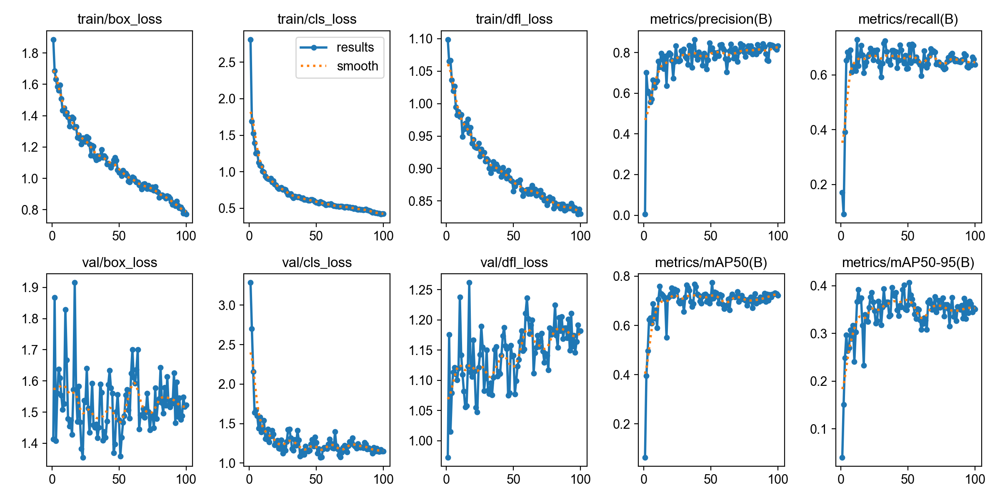
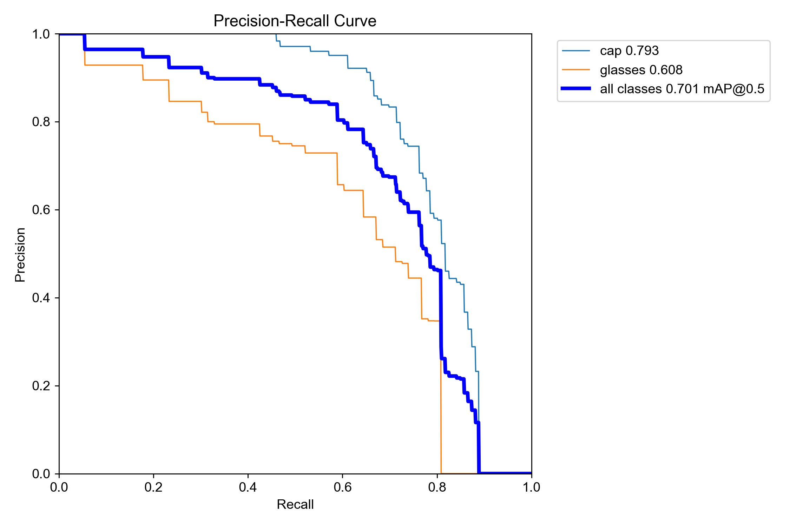
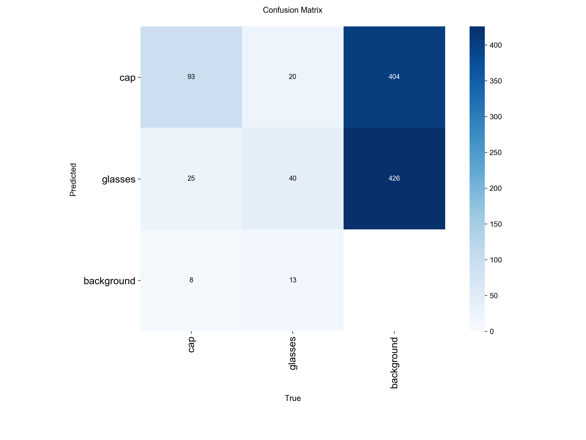

<div align="center">

# 🏊 Underwater Swim Cap & Goggles Detection on the Edge

**On-demand detection and counting of swim caps and swimming goggles underwater,<br>
with a GoPro HERO13, a Raspberry Pi Zero 2 W and a YOLOv8n TensorRT engine on a Jetson Nano.**

[](https://universe.roboflow.com/detect-object-under-water/dataset-real-g3nyo/dataset/4)
[](https://github.com/ultralytics/ultralytics)
[](#-run-on-the-jetson-nano)
[%20%7C%203.14%20(training)-3776AB?logo=python&logoColor=white)](requirements.txt)
[](LICENSE)



<sub>Test photograph GP012113 — left: ground truth, right: prediction (green = cap, blue = goggles).</sub>

</div>

---

## 📌 Contents
- [Overview](#-overview)
- [Results](#-results)
- [Dataset](#-dataset)
- [Quick start](#-quick-start)
- [Run on the Jetson Nano](#-run-on-the-jetson-nano)
- [Repository layout](#-repository-layout)
- [Citation](#-citation)

## 🔍 Overview
Goggles and swim caps that sink to the pool floor are hard to spot from the poolside. Instead of streaming video, this
system takes **still photographs on request** and counts the items in each one.



- **Camera:** GoPro HERO13 Black, 27 MP (5568×4872) JPEG, controlled with the [Open GoPro](https://gopro.github.io/OpenGoPro/) API
- **Detector:** YOLOv8n fine-tuned from COCO weights, letterboxed 640×640 input, confidence 0.35, NMS IoU 0.3
- **Edge inference:** TensorRT FP16 on JetPack 4.6, plain NumPy pre/post-processing — no PyTorch on the device

## 📊 Results
Evaluated once on 22 held-out photographs (199 items) from a capture session not used for training.

| Class | Precision* | Recall* | AP@0.5 | AP@0.5:0.95 |
|:--|:--:|:--:|:--:|:--:|
| 🧢 cap | 0.860 | 0.683 | 0.793 | 0.537 |
| 🥽 goggles | 0.672 | 0.562 | 0.608 | 0.238 |
| **all** | **0.789** | **0.638** | **0.701** | **0.388** |

<sub>* at the operating point (confidence 0.35, NMS IoU 0.3, match IoU 0.5). `results/results_table.md` lists the precision/recall
that Ultralytics reports at its own F1-optimal confidence, so those two columns differ.</sub>

| Counting (per photo) | MAE | RMSE | Exact |
|:--|:--:|:--:|:--:|
| cap | 1.36 | 1.71 | 22.7 % |
| goggles | 0.82 | 1.17 | 45.5 % |
| both classes | 1.09 | 1.46 | 13.6 % |

| Time per photo (median) | |
|:--|:--:|
| Capture + Wi-Fi download (GoPro → Pi) | 6.0 s |
| Processing on the Jetson Nano (read 27 MP JPEG → detect → save) | 2.02 s |
| — of which network inference (640 px, FP16) | 0.18 s |

<details>
<summary>Training curves and evaluation plots</summary>


 
</details>

## 🗂 Dataset
[**Roboflow Universe — `dataset-real-g3nyo`, version 4**](https://universe.roboflow.com/detect-object-under-water/dataset-real-g3nyo/dataset/4) (CC BY 4.0) ·
150 photographs, 18 October 2026, swimming pool of Kasetsart University, Sriracha Campus (1.2 m deep).

| Split | Source | Photos | Caps | Goggles |
|:--|:--|:--:|:--:|:--:|
| train | session 20261018_155420 | 100 + 200 augmented | 496 (1479) | 333 (993) |
| valid | session 20261018_154604, GP012082–GP012109 | 28 | 149 | 107 |
| test | session 20261018_154604, GP012110–GP012131 | 22 | 126 | 73 |

- **Preprocessing:** Auto-Orient only (the training script letterboxes to 640)
- **Augmentation (train only):** crop 0–20 %, rotation ±15°, grayscale 15 %
- **Labelling rules:** reflections on the underside of the water surface are not labelled · distant or blurred items are labelled when identifiable · partly visible items are labelled by their visible extent when identifiable

## 🚀 Quick start
```bash
git clone https://github.com/thanapond-vi/dataset-real-g3nyo.git && cd dataset-real-g3nyo
pip install -r requirements.txt
# download the Roboflow v4 export (YOLOv8 format) into datasets/dataset-real-g3nyo-v4
python3 train_yolov8n.py   --data datasets/dataset-real-g3nyo-v4 --epochs 100 --patience 100 --name model_X3
python3 tune_threshold.py  --data datasets/dataset-real-g3nyo-v4 --split valid --model models/model_X3.pt --iou 0.3 0.4 0.5 0.7
python3 compare_test.py    --data datasets/dataset-real-g3nyo-v4 --split test  --model models/model_X3.pt --out runs/test_compare
```
Paper settings: imgsz 640 · batch 8 · seed 0 · 100 epochs, no early stopping · best checkpoint by validation fitness ·
Ultralytics 8.4.173 · PyTorch 2.14.1 · Apple M4 (MPS).

## 🟩 Run on the Jetson Nano
Requires JetPack 4.6 (TensorRT 8.2, Python 3.6). Copy `jetson/` to the Jetson as `~/pool_detect/`; the first run builds
`models/model_X3_fp16.engine` from the ONNX file with `trtexec` (about 10 minutes, once).
```bash
cd ~/pool_detect
python3 process/predict_folder.py SESSION              # predict images/SESSION/raw/
python3 process/capture_predict.py 10 --pi user@PI_IP  # the Pi takes 10 GoPro photos, then predict
```
From the computer — capture, predict on the Jetson and copy everything back (nothing stays on the Pi or the Jetson):
```bash
python3 jetson/computer/shoot.py 10 --jetson user@JETSON_IP --pi user@PI_IP --session test1
```
Each session folder holds `raw/`, `predicted/`, `compare/` and `results.jsonl`
(`file`, `counts {cap, glasses}`, `total_ms`, `preprocess_ms`, `inference_ms`, `postprocess_ms`).

## 🧭 Repository layout
```text
train_yolov8n.py       letterbox to 640 and fine-tune yolov8n.pt (optionally downloads the Roboflow export)
letterbox.py           aspect-preserving resize + gray padding, shared by training and the Jetson
tune_threshold.py      precision / recall / F1 over a grid of confidence and NMS IoU
compare_test.py        ground truth vs prediction images for a split
collect_experiment.py  collects metrics, logs, plots and environment into one folder
models/model_X3.pt     final weights
jetson/process/        Jetson Nano: TensorRT inference, counting, comparison images
jetson/capture/        Raspberry Pi: GoPro capture over Wi-Fi / BLE
jetson/computer/       computer: one command for capture → predict → copy back
jetson/models/         model_X3.onnx (opset 12, 640 px)
results/               metrics, training history, evaluation plots, per-photo test counts
```

## 📝 Citation
```bibtex
@misc{chansuksri2026pooledge,
  author = {Chansuksri, Pisitpong and Visessang, Thanapond and Chumchu, Prawit},
  title  = {On-Demand Underwater Detection and Counting of Swimming Goggles and Swim Caps Using Edge AI},
  year   = {2026},
  note   = {Under review},
  url    = {https://github.com/thanapond-vi/dataset-real-g3nyo}
}
```

## 🙏 Acknowledgments
Faculty of Engineering at Sriracha, Kasetsart University · [Ultralytics YOLO](https://github.com/ultralytics/ultralytics) ·
[Roboflow](https://roboflow.com) · [Open GoPro](https://gopro.github.io/OpenGoPro/) · NVIDIA TensorRT.

## 📄 License
[AGPL-3.0](LICENSE) — the training code and weights build on Ultralytics YOLO (AGPL-3.0). The dataset is CC BY 4.0.
